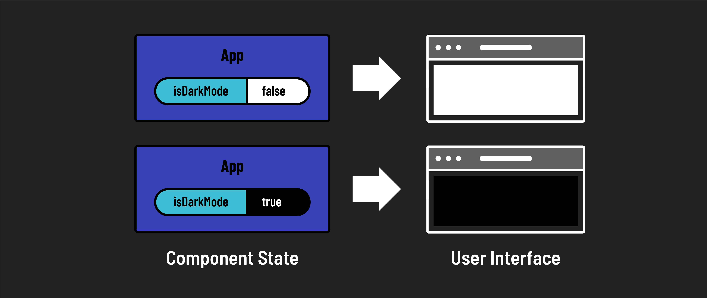
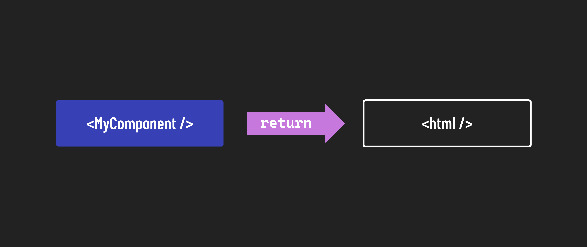
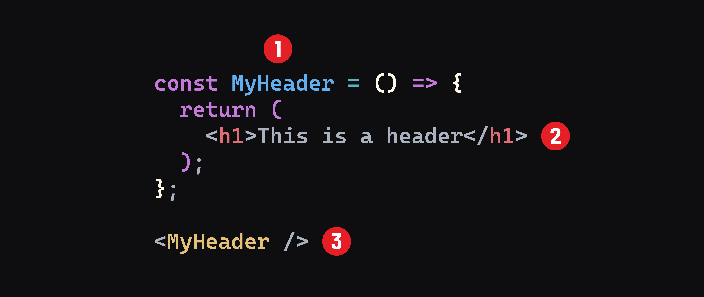
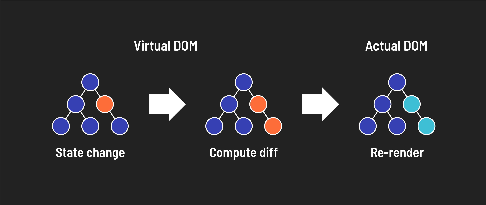

# 

**Learning objective:** By the end of this lesson, students will be able to describe the prominent features of React.

## Features of React

React is a powerful library that has become the go-to choice for many developers. It has several features that make it a popular choice for building user interfaces. These features include:

- **State Management**
- **Modular Components**
- **JSX**
- **Virtual DOM**
- **React Ecosystem**

### State management

When building components in a React app, it becomes useful for the components to have the ability to change dynamically based on data. This ability to change makes a React page dynamic. React enforces this concept by using something known as _state_. 

**State**, in terms of React, is a component object that tracks any changes to information contained in the state object. So, if data changes in the state object of a component, that component is updated ( or rerendered ) to reflect the update. This is useful because only components with state change will rerender while others do not. The modularity and independence of the components allow for smoother updating without needing a page refresh.

### Modular components

**Per the React [documentation](https://react.dev/learn#components)**:

> React apps are made out of components. A component is a piece of the UI (user interface) with its own logic and appearance. A component can be as small as a button or as large as an entire page.

> React components are JavaScript functions that return markup.

A core concept of programming in React is the ability to write and reuse components throughout an entire application. This practice is reinforced by having all components rendered through a single HTML document in the browser. One can also import and render as many components as needed inside other components. The result of this structure encourages users to think in a more modular manner as they begin to see patterns emerge from their work. A developer can even write logic to render ( or not render ) sub-components based on the information housed in the state of a parent component.

### JSX: Mixin' it up!

React utilizes JSX, an XML-like syntax extension to JavaScript. XML is short for extensible markup language. JSX was created by Facebook for use in React. It provides a way to concisely define tree structures with attributes - perfect for defining a DOM tree! It is _transpiled_ into pure JavaScript. JSX is simple and easy to read. Compared to pure JavaScript, JSX provides a more concise and more straightforward (better) way to define a UI. JSX resembles HTML, allowing us to visualize the UI its JavaScript will create more easily.

This is what JSX looks like in the context of a component:

1. The function definition. Determines the name of the component.
2. The markup returned from the component.
3. The syntax used to render the component.

> _Transpiled_ is when code is converted from one language to another. In the case of JSX, it is converted to JavaScript.

### Virtual DOM: React creates a shadow version of the dom that inherits in case of a nuclear disaster.

React handles UI updates through a mechanism known as the **Virtual Dom**. The Virtual DOM represents the actual DOM and is a staging area for changes that will eventually be implemented. Because of that, React can keep track of changes in the actual DOM by comparing different instances of the Virtual DOM.

Here is a breakdown of the process:

- React renders an in-memory representation of the DOM, known as the **Virtual DOM**.
- After the rendering, React compares the latest Virtual DOM to the previous Virtual DOM and computes only the difference, known as the **diff**.
- React then updates the browser's actual DOM with the actual changes (the computed **diff**).

## React Ecosystem

React boasts a large ecosystem of tools, libraries, and frameworks that serve to expand and augment the capabilities of React.

The React ecosystem includes:

- **React Native**: React Native is a framework for building mobile applications using the same principles as React JS. 

- **React Router**: React Router is a tool for adding client-side navigation to single-page React applications. It uses URLs to dynamically update the user interface, creating the experience of a multi-page app.

- **React-based Libraries**: A variety of libraries expand on React. These libraries are accessible through [NPM](https://www.npmjs.com/) and often deal with specific use cases.

- **Build Tools**: Tools like Create React App (CRA) and Vite, are significant aspects of the React ecosystem. They streamline the setup and build process and allow developers to focus on code rather than the app's configuration.

> As of this writing, Create React App is being phased out; however, you will likely encounter code or references to CRA as it was the predominant method for generating a React App.

- **React-based Frameworks**: In recent years, frameworks built on React have emerged as solutions for the perceived shortcomings of the React library. These frameworks include tools like Next.js and Remix. They offer features like server-side rendering and static site generation, which are helpful for SEO and optimization.