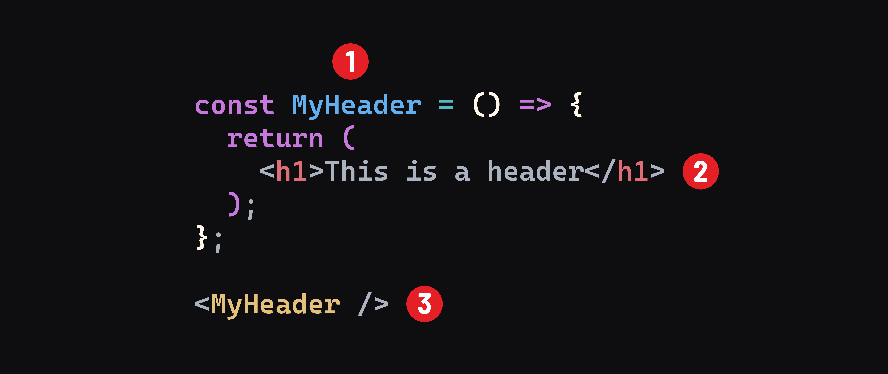

# 

**Learning objective:** By the end of this lesson, students will be introduced to the use of JSX in React. 

## JSX: Mixin' it up!

React utilizes JSX, an XML-like syntax extension to JavaScript. XML is short for extensible markup language. JSX was created by Facebook for use in React. It provides a way to concisely define tree structures with attributes - perfect for defining a DOM tree! It is _transpiled_ into pure JavaScript. JSX is simple and easy to read. Compared to pure JavaScript, JSX provides a more concise and more straightforward (better) way to define a UI. JSX resembles HTML, allowing us to visualize the UI its JavaScript will create more easily.

This is what JSX looks like in the context of a component:

1. The function definition. Determines the name of the component.
2. The markup returned from the component.
3. The syntax used to render the component.

> _Transpiled_ is when code is converted from one language to another. In the case of JSX, it is converted to JavaScript.