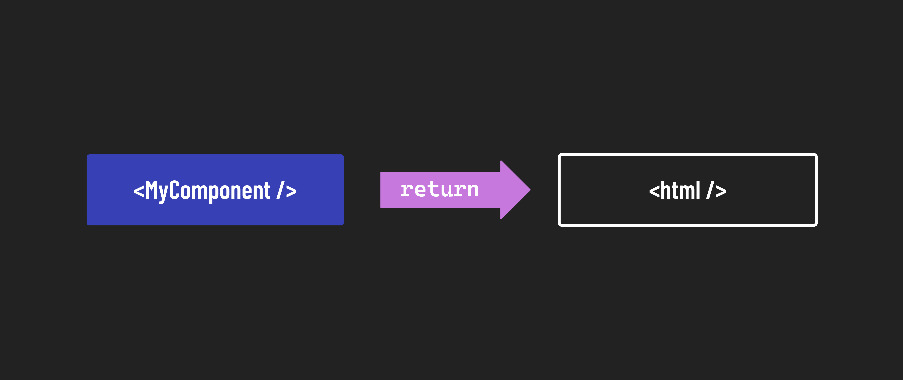

# 

**Learning objective:** By the end of this lesson, students will be introduced to the concept of modular components in React.

## Modular components

**Per the React [documentation](https://react.dev/learn#components)**:

> React apps are made out of components. A component is a piece of the UI (user interface) with its own logic and appearance. A component can be as small as a button or as large as an entire page.

> React components are JavaScript functions that return markup.

A core concept of programming in React is the ability to write and reuse components throughout an entire application. This practice is reinforced by having all components rendered through a single HTML document in the browser. One can also import and render as many components as needed inside other components. The result of this structure encourages users to think in a more modular way as they begin to see patterns emerge from their work. A developer can even write logic to render ( or not render ) sub-components based on the information housed in the state of a parent component.

