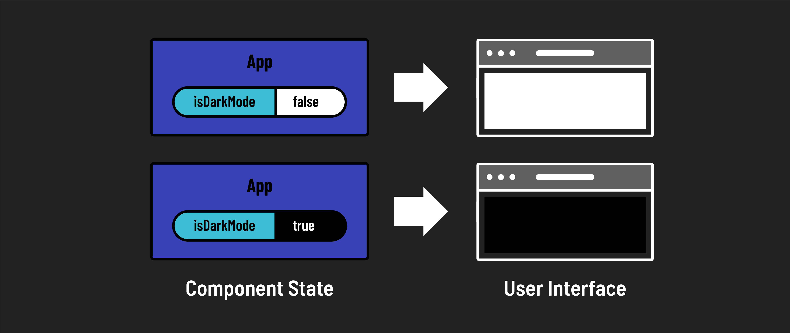

# 

**Learning objective:** By the end of this lesson, students will be introduced to the concept of state in React.

## State management

When building components in a React app, it becomes useful for the components to have the ability to change dynamically based on data. This ability to change makes a React page dynamic. React enforces this concept by using something known as _state_. **State**, in terms of React, is a component object that tracks any changes to information contained in the state object. So, if data changes in the state object of a component, that component is updated ( or rerendered ) to reflect the update. This is useful because only components with state change will rerender while others do not. The modularity and independence of the components allow for smoother updating without needing a page refresh.

**State**, in terms of React, is a component object that tracks any changes to information contained in the state object. So, if data changes in the state object of a component, that component is updated ( or rerendered ) to reflect the update. This is useful because only components with state change will rerender while others do not. The modularity and independence of the components allow for smoother updating without needing a page refresh.

