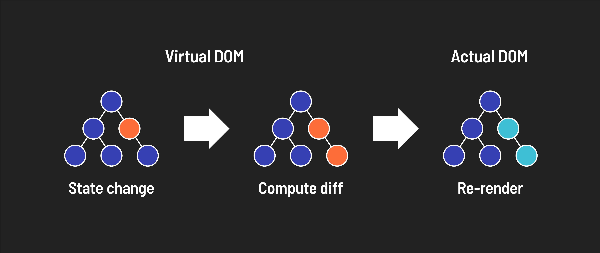

# 

**Learning objective:** By the end of this lesson, students will be able to describe how React uses a virtual DOM to make targeted updates to the UI.

## Virtual DOM

React handles UI updates through a mechanism known as the **Virtual Dom**. The Virtual DOM represents the actual DOM and is a staging area for changes that will eventually be implemented. Because of that, React can keep track of changes in the actual DOM by comparing different instances of the Virtual DOM.

Here is a breakdown of the process:

- React renders an in-memory representation of the DOM, known as the **Virtual DOM**.
- After the rendering, React compares the latest Virtual DOM to the previous Virtual DOM and computes only the difference, known as the **diff**.
- React then updates the browser's actual DOM with the actual changes (the computed **diff**).

